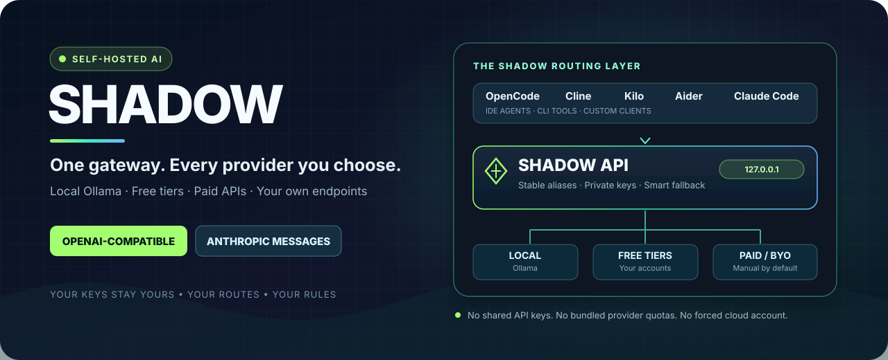
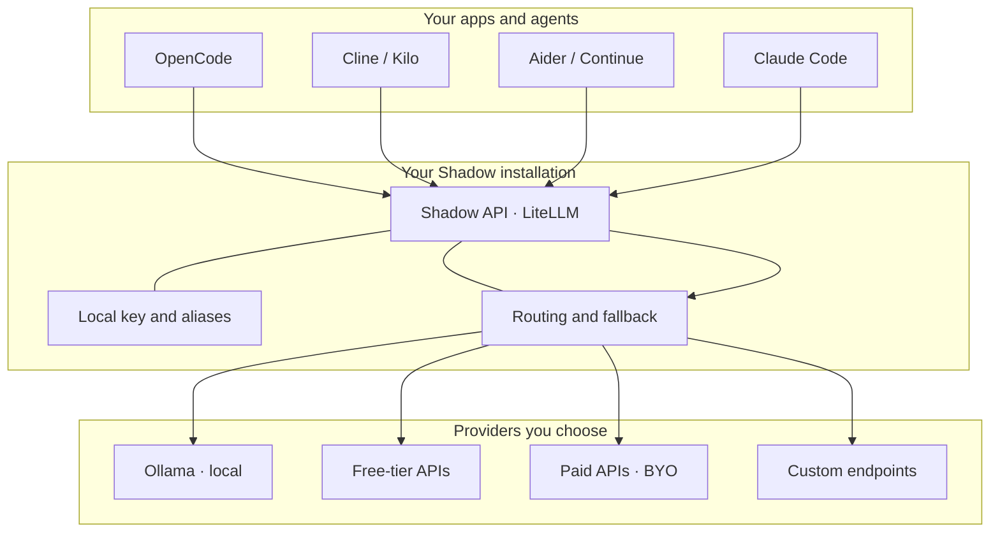

<div align="center">
  
  <br/>
  <a href="README.md">🇧🇷 Português</a> &nbsp;·&nbsp; <strong>🌐 EN</strong>
  <br/><br/>
  <a href="https://github.com/Ninja7z/shadow/stargazers"></a>
  <a href="https://www.python.org/"></a>
  <a href="https://docs.litellm.ai/"></a>
  <a href="LICENSE"></a>
  <a href="https://github.com/Ninja7z/shadow/issues"></a>
</div>

<p align="center">
  <a href="#-what-is-shadow">What it is</a> ·
  <a href="#-one-command-to-get-started">Get started</a> ·
  <a href="#-connect-your-providers">Providers</a> ·
  <a href="#-one-api-for-your-apps">Apps</a> ·
  <a href="#-architecture">Architecture</a> ·
  <a href="#-security-privacy-and-costs">Security</a>
</p>

---

# ◈ What is Shadow?

**Shadow is your personal AI gateway.** A local layer between your agents and model providers, bringing everything behind an API you control.

Stop scattering endpoints and upstream keys across every app. Connect providers to Shadow once. Then point OpenCode, Cline, Kilo, Continue, Aider, Claude Code or any compatible client at your local API.

- **Local:** run models with Ollama on your own hardware.
- **Free tiers:** connect providers with free quotas using your own accounts.
- **Paid:** add commercial APIs when you decide to.
- **Custom:** bring your own OpenAI-compatible or Anthropic Messages endpoints.
- **Unified:** expose consistent aliases through OpenAI Chat Completions and Anthropic Messages.

> **Shadow is not a hosted inference service.** It is the software that organizes and routes your requests. Local models use your hardware; remote providers use your accounts, quotas, policies and billing arrangements.

## ✦ Why use it?

| Without Shadow | With Shadow |
|---|---|
| Every app stores multiple upstream keys. | Apps use the local Shadow key. |
| Switching providers means reconfiguring clients. | Switch routes by changing a model alias. |
| Every client maintains a different endpoint list. | One gateway centralizes compatible endpoints. |
| Fallback is scattered or missing. | A configurable chain organizes alternatives. |
| Adding an endpoint means editing several apps. | Register once and discover its alias at `/v1/models`. |

## ⚡ One command to get started

**Linux, macOS or Windows with Node.js 20.12+ and npm:**

```bash
npx shadow-gateway
```

The installer guides the entire setup in your terminal: detects dependencies, provisions `uv` and Python 3.12 when missing, installs the gateway, asks how you want to use Shadow, configures providers and validates the installation. At the end, it offers to install the permanent `shadow` command. The npm package is named `shadow-gateway`; its installed executable is `shadow`.

After setup:

```bash
shadow start
```

Without a global install, use `npx shadow-gateway start`. The installer does not install Ollama or download large models without asking. See the [complete terminal installation guide](docs/terminal-installation.md).

<details>
<summary><strong>Install from source (developers)</strong></summary>

```bash
git clone https://github.com/Ninja7z/shadow.git
cd shadow
python scripts/shadow.py onboard
python scripts/shadow.py start
```

</details>

<details>
<summary><strong>Prefer manual setup?</strong></summary>

```bash
python scripts/shadow.py setup
python scripts/shadow.py configure
python scripts/shadow.py refresh
python scripts/shadow.py validate
python scripts/shadow.py start
```

</details>

### What does onboarding prepare?

1. Creates `.venv/` and installs gateway dependencies.
2. Creates a private `.env` and generates `LITELLM_MASTER_KEY`.
3. Builds a starter configuration with `shadow-local` and `shadow-auto`.
4. Checks whether Ollama is available.
5. Lets you enable catalog providers or register your own endpoints.
6. Shows how to connect your apps.

The initial installation does not require a cloud account or an external API key.

## 🧭 Choose how you want to run it

<div align="center">
<table>
  <tr>
    <td align="center" width="33%">
      <h3>🖥️ LOCAL</h3>
      <strong>Ollama</strong><br/>
      Your models on your hardware.<br/>
      <sub>No remote API key required.</sub>
    </td>
    <td align="center" width="33%">
      <h3>🆓 FREE TIERS</h3>
      <strong>Your accounts</strong><br/>
      Connect providers with free quotas.<br/>
      <sub>Limits and eligibility vary.</sub>
    </td>
    <td align="center" width="33%">
      <h3>⚙️ BYO API</h3>
      <strong>Your endpoints</strong><br/>
      Free, paid or mixed-access.<br/>
      <sub>You control automatic fallback.</sub>
    </td>
  </tr>
</table>
</div>

### Local mode

Install [Ollama](https://ollama.com/), pull a model and keep the service running:

```bash
ollama pull llama3.2:3b
```

You can change the starter model in `config/shadow.example.yaml` before setup, or in your private local configuration after setup.

### Interactive assistant

Run onboarding again whenever you want to review your options:

```bash
python scripts/shadow.py onboard
```

| Option | Action |
|---|---|
| `1` | Check Ollama and local models. |
| `2` | Connect a provider from the catalog. |
| `3` | Register a custom endpoint. |
| `4` | Show client connection instructions. |
| `5` | Refresh configuration and finish. |

## 🔌 Connect your providers

### Starter catalog

The repository includes adapters for:

| Provider | Access model listed in the catalog |
|---|---|
| Google Gemini | Free tier and paid plans |
| Groq | Free tier and paid plans |
| OpenRouter | Free and paid models |
| Hugging Face | Credits and paid plans |
| Requesty | Free tier and paid plans |
| Gonka Broker | Free tier |
| BazaarLink | Free tier |
| Cloudflare Workers AI | Daily free quota and paid usage |
| DeepSeek | Paid |
| Mistral | Free trial and paid plans |
| OpenAI | Paid |
| Anthropic | Paid |

These labels describe the access model listed in the catalog. They **do not guarantee** availability, price, eligibility or quota for your account. Check each provider's dashboard and current terms. To protect against surprise charges, `shadow-auto` only includes catalog providers classified as free-only; mixed-access (free + paid) services remain manual-selection routes, even when they offer a free quota.

To add a catalog provider key, choose option `2` in onboarding or run:

```bash
python scripts/shadow.py configure
```

Fill only the credentials for providers you choose in your private `.env`. Cloudflare Workers AI also requires `CLOUDFLARE_ACCOUNT_ID`. Then:

```bash
python scripts/shadow.py refresh
```

Restart the gateway to load the updated configuration.

### Bring any compatible endpoint

Can't find your provider in the catalog? Register as many custom endpoints as you need, without editing the source code:

```bash
python scripts/shadow.py add-provider
```

The wizard asks for:

- A short ID and display name.
- Protocol: OpenAI Chat Completions or Anthropic Messages.
- Base URL and exact upstream model ID.
- Access type: `free`, `paid`, `mixed` or `unknown`.
- API key, entered without echoing it to the terminal.

Each endpoint receives its own model alias, for example `shadow-custom-my-api`.

**The separation is deliberate:**
- The key stays in the private `.env` file with restricted permissions.
- Endpoint metadata lives in `config/providers.local.yaml`, which Git ignores.
- Custom endpoints are manual-only by default.
- Free endpoints can be explicitly opted into automatic fallback.
- Paid or mixed-access endpoints only join fallback after you type `SIM` to confirm the potential charges.

Then:

```bash
python scripts/shadow.py refresh
python scripts/shadow.py configure
```

Restart Shadow. Your endpoint appears in the model catalog when its credential is present and its configuration is valid.

**Compatibility has boundaries:** endpoints implementing OpenAI Chat Completions or Anthropic Messages can be connected directly. Proprietary APIs or different protocols need a LiteLLM-compatible adapter.

## 🧠 One API for your apps

By default, the gateway listens only on `127.0.0.1:4000`.

| Interface | Endpoint / Base URL |
|---|---|
| OpenAI-compatible Base URL | `http://127.0.0.1:4000/v1` |
| OpenAI Chat Completions | `http://127.0.0.1:4000/v1/chat/completions` |
| OpenAI Responses | `http://127.0.0.1:4000/v1/responses` |
| Anthropic Messages | `http://127.0.0.1:4000/v1/messages` |
| Model catalog | `http://127.0.0.1:4000/v1/models` |
| Health check | `http://127.0.0.1:4000/health/liveliness` |

For OpenAI-compatible clients, use the Base URL ending in `/v1`. For Anthropic clients that append `/v1/messages` automatically, use the gateway root: `http://127.0.0.1:4000`.

### Discover available models

The catalog reflects what you configured. Query `/v1/models` to get the actual aliases:

```bash
set -a
source .env
set +a

curl -fsS http://127.0.0.1:4000/v1/models \
  -H "Authorization: Bearer $LITELLM_MASTER_KEY"
```

Common aliases:

| Alias | Purpose |
|---|---|
| `shadow-local` | Configured local Ollama model. |
| `shadow-auto` | Automatic route using authorized alternatives and the local model as final fallback. |
| `shadow-custom-<id>` | Your registered custom endpoint. |
| `shadow-*` | Catalog providers you enabled. |

Always use the exact `id` returned by `/v1/models`. Do not assume every alias exists in a fresh installation.

### Compatible clients

<div align="center">
<table>
  <tr>
    <td align="center"><strong>OpenCode</strong></td>
    <td align="center"><strong>Cline</strong></td>
    <td align="center"><strong>Kilo Code</strong></td>
  </tr>
  <tr>
    <td align="center"><strong>Continue</strong></td>
    <td align="center"><strong>Aider</strong></td>
    <td align="center"><strong>Claude Code</strong></td>
  </tr>
</table>
</div>

Copy-ready setup instructions, including Windows PowerShell:

**[Open the English client integration guide](docs/client-integrations.md)** · **[Abrir guia em português](docs/pt-BR/integracao-clientes.md)**

Clients receive only the local Shadow master key. Upstream keys stay centralized in the gateway.

## 🏗️ Architecture



Shadow routes **model inference**. The MCP Hub routes **tool calls**. They are separate components with independent configuration, credentials and lifecycles.

## 🧰 Optional MCP Hub

The repository also includes a local MCP server aggregator. It lets MCP-compatible clients share tools from external services through a single local `stdio` connection.

- Model API: LiteLLM HTTP endpoints on port `4000`.
- MCP Hub: local tool server over `stdio`.
- OAuth, tokens and MCP permissions: configured separately for each installation.

The basic gateway setup does not automatically authorize external accounts. See the **[MCP Hub guide](docs/mcp-hub.md)** before enabling integrations.

## 🛡️ Security, privacy and costs

- `LITELLM_MASTER_KEY` is an administrative key. Use it only for a single-user local installation.
- The gateway binds to `127.0.0.1`; do not expose it directly to a network or the internet.
- Do not share `.env`, `config/shadow.yaml`, `config/providers.local.yaml`, OAuth tokens or session files.
- Never put upstream provider keys in agent settings.
- Remote providers receive the requests routed to them. Review privacy and retention policies before sending sensitive data.
- For multiple users or devices, configure LiteLLM virtual-key authentication, budgets, limits, TLS and private networking before sharing the service.

### What “free” means here

Shadow does not bundle shared keys or purchase quotas for you. Remote usage depends on your own provider accounts. Providers may change models, limits, eligibility, prices or availability. Local mode avoids remote API calls, but uses your machine's hardware, power and storage.

## 🧪 Tests and diagnostics

Validate the configuration:

```bash
python scripts/shadow.py validate
```

Run safe health checks without inference:

```bash
python scripts/smoke_test.py
```

Optional tool-calling tests send real inference requests and may consume quota or incur charges:

```bash
python scripts/smoke_test.py --tool-calls --model shadow-auto
python scripts/smoke_test.py --anthropic-tools --anthropic-model shadow-auto
```

Automated test suites for the Python core and npm installer:

```bash
python -m unittest discover -s tests -v
npm test
```

Unit tests use local fixtures and do not call external providers.

## 📁 Repository map

| Path | Contents |
|---|---|
| `README.md` | Main page in Portuguese. |
| `README.en.md` | Main page in English. |
| `package.json` | npm package and `shadow` executable. |
| `bin/shadow.js` | Cross-platform terminal launcher. |
| `src/installer.js` | Interactive installer and runtime provisioning. |
| `docs/assets/shadow-hero*.svg` | Portuguese and English vector hero artwork. |
| `docs/terminal-installation.md` | npm terminal installer and commands in English. |
| `docs/pt-BR/instalacao-terminal.md` | Instalação e comandos do CLI npm em português. |
| `scripts/shadow.py` | Setup, onboarding, provider registration, refresh, validation and start. |
| `config/shadow.example.yaml` | Local-first starter configuration. |
| `config/providers.catalog.yaml` | Public catalog of optional providers. |
| `config/shadow.runtime.example.yaml` | Sanitized LiteLLM configuration example. |
| `scripts/smoke_test.py` | Health checks and protocol tests. |
| `scripts/shadow-mcp-hub.sh` | Local MCP Hub launcher. |
| `docs/` | Portuguese and English guides. |
| `tests/` | Automated tests. |

Machine-specific files such as `.env`, `.venv/`, `config/shadow.yaml` and `config/providers.local.yaml` are private and ignored by Git.

## ⚖️ License

Shadow is licensed under the **PolyForm Noncommercial License 1.0.0** (`PolyForm-Noncommercial-1.0.0`). It permits use, modification and distribution for noncommercial purposes, including personal use and certain noncommercial organizations. **Commercial use is prohibited.**

The Shadow license does not grant rights to third-party APIs, models, SDKs or services. Each provider retains its own terms, licenses, prices and policies.

- [LICENSE](LICENSE)
- [Official PolyForm Noncommercial 1.0.0 text](https://polyformproject.org/licenses/noncommercial/1.0.0)
- [Portuguese explanation](docs/pt-BR/licenca.md)

---

<div align="center">
  <h3>Your agents. Your providers. Your rules.</h3>
  <p><a href="https://github.com/Ninja7z/shadow">⭐ Visit the repository</a> · <a href="https://github.com/Ninja7z/shadow/issues">Report an issue</a></p>
  <sub>Shadow · Self-hosted AI Gateway</sub>
</div>
