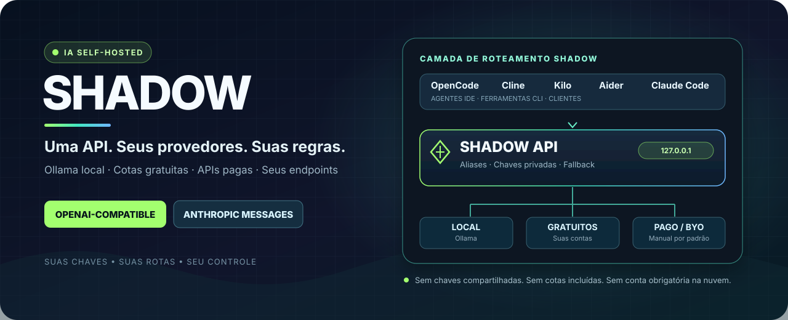
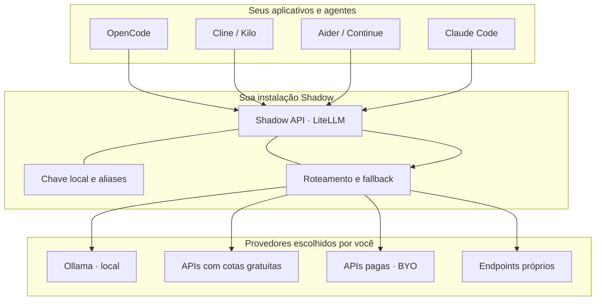

<div align="center">
  
  <br/>
  <strong>🌐 PT-BR</strong> &nbsp;·&nbsp; <a href="README.en.md">🇺🇸 English</a>
  <br/><br/>
  <a href="https://github.com/Ninja7z/shadow/stargazers"></a>
  <a href="https://www.python.org/"></a>
  <a href="https://docs.litellm.ai/"></a>
  <a href="LICENSE"></a>
  <a href="https://github.com/Ninja7z/shadow/issues"></a>
</div>

<p align="center">
  <a href="#-o-que-é-shadow">O que é</a> ·
  <a href="#-comece-em-um-comando">Começar</a> ·
  <a href="#-conecte-seus-provedores">Provedores</a> ·
  <a href="#-uma-api-para-seus-aplicativos">Aplicativos</a> ·
  <a href="#-arquitetura">Arquitetura</a> ·
  <a href="#-segurança-privacidade-e-custos">Segurança</a>
</p>

---

# ◈ O que é Shadow?

**Shadow é seu gateway pessoal de IA.** Uma camada local entre seus agentes e os provedores de modelos, reunindo tudo em uma API que você controla.

Pare de espalhar endpoints e chaves por cada aplicativo. Conecte seus provedores uma vez no Shadow. Depois, conecte OpenCode, Cline, Kilo, Continue, Aider, Claude Code ou qualquer cliente compatível à sua API local.

- **Local:** rode modelos com Ollama, usando sua própria máquina.
- **Gratuito:** conecte provedores com cotas gratuitas usando suas próprias contas.
- **Pago:** adicione APIs comerciais quando você decidir.
- **Personalizado:** conecte seus próprios endpoints OpenAI-compatible ou Anthropic Messages.
- **Unificado:** exponha aliases consistentes por OpenAI Chat Completions e Anthropic Messages.

> **Shadow não é um serviço de inferência hospedado.** Ele é o software que organiza e encaminha suas chamadas. Modelos locais usam seu hardware; provedores remotos usam suas contas, cotas, políticas e formas de cobrança.

## ✦ Por que usar?

| Sem Shadow | Com Shadow |
|---|---|
| Cada aplicativo guarda várias chaves upstream. | Os aplicativos usam a chave local do Shadow. |
| Trocar de provedor exige reconfigurar clientes. | Troque a rota usando um alias. |
| Cada cliente tem sua própria lista de endpoints. | Um gateway centraliza os endpoints compatíveis. |
| Fallback fica espalhado ou é inexistente. | Uma cadeia configurável organiza as alternativas. |
| Um endpoint novo exige editar várias configurações. | Cadastre uma vez e descubra o alias em `/v1/models`. |

## ⚡ Comece em um comando

**Linux, macOS ou Windows com Node.js 20.12+ e npm:**

```bash
npx shadow-gateway
```

O instalador conduz tudo pelo terminal: detecta dependências, prepara `uv` e Python 3.12 quando faltarem, instala o gateway, pergunta como você quer usar o Shadow, configura provedores e valida a instalação. No final, oferece instalar o comando permanente `shadow`. O pacote npm chama-se `shadow-gateway`; o executável instalado chama-se `shadow`.

Depois da configuração:

```bash
shadow start
```

Sem instalação global, use `npx shadow-gateway start`. O instalador não instala Ollama ou baixa modelos grandes sem perguntar. Consulte o [guia completo de instalação pelo terminal](docs/pt-BR/instalacao-terminal.md).

<details>
<summary><strong>Instalação a partir do código-fonte (desenvolvedores)</strong></summary>

```bash
git clone https://github.com/Ninja7z/shadow.git
cd shadow
python scripts/shadow.py onboard
python scripts/shadow.py start
```

</details>

<details>
<summary><strong>Prefere configurar manualmente?</strong></summary>

```bash
python scripts/shadow.py setup
python scripts/shadow.py configure
python scripts/shadow.py refresh
python scripts/shadow.py validate
python scripts/shadow.py start
```

</details>

### O que o onboarding prepara?

1. Cria `.venv/` e instala as dependências do gateway.
2. Cria `.env` privado e gera `LITELLM_MASTER_KEY`.
3. Monta uma configuração inicial com `shadow-local` e `shadow-auto`.
4. Verifica se Ollama está disponível.
5. Permite ativar provedores catalogados ou cadastrar endpoints próprios.
6. Mostra como conectar seus aplicativos.

A instalação inicial não precisa de uma conta de nuvem nem de uma chave de API externa.

## 🧭 Escolha como quer rodar

<div align="center">
<table>
  <tr>
    <td align="center" width="33%">
      <h3>🖥️ LOCAL</h3>
      <strong>Ollama</strong><br/>
      Seus modelos no seu hardware.<br/>
      <sub>Sem chave de API remota.</sub>
    </td>
    <td align="center" width="33%">
      <h3>🆓 FREE TIER</h3>
      <strong>Suas contas</strong><br/>
      Conecte provedores com cotas gratuitas.<br/>
      <sub>Limites e elegibilidade variam.</sub>
    </td>
    <td align="center" width="33%">
      <h3>⚙️ BYO API</h3>
      <strong>Seus endpoints</strong><br/>
      Gratuitos, pagos ou mistos.<br/>
      <sub>Você controla quando entram no fallback.</sub>
    </td>
  </tr>
</table>
</div>

### Modo local

Instale [Ollama](https://ollama.com/), baixe um modelo e mantenha o serviço ativo:

```bash
ollama pull llama3.2:3b
```

O modelo inicial pode ser alterado em `config/shadow.example.yaml` antes de preparar uma instalação, ou na configuração privada local depois do setup.

### Assistente interativo

Execute o onboarding novamente sempre que quiser rever as opções:

```bash
python scripts/shadow.py onboard
```

| Opção | O que faz |
|---|---|
| `1` | Verifica Ollama e os modelos locais. |
| `2` | Conecta uma API do catálogo. |
| `3` | Cadastra um endpoint próprio. |
| `4` | Mostra como conectar os aplicativos. |
| `5` | Atualiza a configuração e encerra. |

## 🔌 Conecte seus provedores

### Catálogo inicial

O repositório inclui adaptadores para estes provedores:

| Provedor | Acesso indicado no catálogo |
|---|---|
| Google Gemini | Cota gratuita e planos pagos |
| Groq | Cota gratuita e planos pagos |
| OpenRouter | Modelos gratuitos e pagos |
| Hugging Face | Créditos e planos pagos |
| Requesty | Cota gratuita e planos pagos |
| Gonka Broker | Cota gratuita |
| BazaarLink | Cota gratuita |
| Cloudflare Workers AI | Cota diária gratuita e uso pago |
| DeepSeek | Pago |
| Mistral | Teste gratuito e planos pagos |
| OpenAI | Pago |
| Anthropic | Pago |

Esses rótulos descrevem o tipo de acesso declarado no catálogo, **não garantem** disponibilidade, preço, elegibilidade ou cota para sua conta. Consulte o painel e os termos atuais de cada provedor. Para proteger contra cobranças inesperadas, `shadow-auto` só inclui provedores catalogados como exclusivamente gratuitos; serviços com acesso misto (gratuito + pago) permanecem em seleção manual, mesmo que ofereçam uma cota grátis.

Para cadastrar uma chave do catálogo, escolha a opção `2` no onboarding ou execute:

```bash
python scripts/shadow.py configure
```

Preencha somente as credenciais que você deseja usar no `.env` privado. Para ativar Cloudflare Workers AI, informe também `CLOUDFLARE_ACCOUNT_ID`. Depois:

```bash
python scripts/shadow.py refresh
```

Reinicie o gateway para carregar a configuração atualizada.

### Traga qualquer endpoint compatível

Não encontrou seu provedor? Cadastre quantos endpoints próprios precisar, sem editar o código:

```bash
python scripts/shadow.py add-provider
```

O assistente pergunta:

- Identificador e nome para exibição.
- Protocolo: OpenAI Chat Completions ou Anthropic Messages.
- Base URL e ID exato do modelo.
- Tipo de acesso: `free`, `paid`, `mixed` ou `unknown`.
- Chave de API, digitada sem aparecer na tela.

Cada endpoint recebe seu próprio alias, por exemplo `shadow-custom-minha-api`.

**A separação é intencional:**
- A chave fica no `.env` privado, com permissão restrita.
- Os metadados ficam em `config/providers.local.yaml`, ignorado pelo Git.
- APIs próprias ficam em seleção manual por padrão.
- APIs gratuitas podem ser autorizadas para fallback automático.
- APIs pagas ou mistas só entram no fallback se você digitar `SIM` após o aviso de cobrança potencial.

Em seguida:

```bash
python scripts/shadow.py refresh
python scripts/shadow.py configure
```

Reinicie o gateway. A API própria aparecerá no catálogo se sua credencial estiver presente e a configuração for válida.

**Compatibilidade tem limite:** endpoints que implementam OpenAI Chat Completions ou Anthropic Messages podem ser conectados diretamente. APIs proprietárias ou com protocolo diferente precisam de um adaptador compatível com LiteLLM.

## 🧠 Uma API para seus aplicativos

Por padrão, o gateway escuta somente em `127.0.0.1:4000`.

| Interface | Endpoint / Base URL |
|---|---|
| Base URL OpenAI-compatible | `http://127.0.0.1:4000/v1` |
| OpenAI Chat Completions | `http://127.0.0.1:4000/v1/chat/completions` |
| OpenAI Responses | `http://127.0.0.1:4000/v1/responses` |
| Anthropic Messages | `http://127.0.0.1:4000/v1/messages` |
| Catálogo de modelos | `http://127.0.0.1:4000/v1/models` |
| Health check | `http://127.0.0.1:4000/health/liveliness` |

Para clientes OpenAI-compatible, use a Base URL terminada em `/v1`. Para clientes Anthropic que acrescentam `/v1/messages` automaticamente, use a raiz `http://127.0.0.1:4000`.

### Descubra os modelos disponíveis

O catálogo depende do que você configurou. Consulte `/v1/models` para obter os aliases reais:

```bash
set -a
source .env
set +a

curl -fsS http://127.0.0.1:4000/v1/models \
  -H "Authorization: Bearer $LITELLM_MASTER_KEY"
```

Aliases comuns:

| Alias | Finalidade |
|---|---|
| `shadow-local` | Modelo local Ollama configurado. |
| `shadow-auto` | Rota automática com alternativas autorizadas e fallback local final. |
| `shadow-custom-<id>` | Endpoint próprio cadastrado por você. |
| `shadow-*` | Provedores do catálogo que você habilitou. |

Use sempre o `id` exato retornado por `/v1/models`. Não suponha que todo alias esteja presente em uma instalação nova.

### Clientes compatíveis

<div align="center">
<table>
  <tr>
    <td align="center"><strong>OpenCode</strong></td>
    <td align="center"><strong>Cline</strong></td>
    <td align="center"><strong>Kilo Code</strong></td>
  </tr>
  <tr>
    <td align="center"><strong>Continue</strong></td>
    <td align="center"><strong>Aider</strong></td>
    <td align="center"><strong>Claude Code</strong></td>
  </tr>
</table>
</div>

Configurações detalhadas para cada cliente, inclusive Windows PowerShell:

**[Abrir guia de integração PT-BR](docs/pt-BR/integracao-clientes.md)** · **[Open the English client guide](docs/client-integrations.md)**

O cliente recebe somente a chave mestra local do Shadow. As chaves upstream ficam centralizadas no gateway.

## 🏗️ Arquitetura



O Shadow organiza chamadas de **modelos**. O MCP Hub organiza chamadas de **ferramentas**. São componentes separados, com configurações, credenciais e ciclo de vida independentes.

## 🧰 MCP Hub opcional

O repositório também inclui um agregador local de servidores MCP. Ele permite que clientes compatíveis compartilhem ferramentas de serviços externos por uma única conexão `stdio`.

- API de modelos: LiteLLM HTTP na porta `4000`.
- MCP Hub: servidor de ferramentas local via `stdio`.
- OAuth, tokens e permissões MCP: configuração própria de cada instalação.

A instalação básica do gateway não autoriza contas externas automaticamente. Consulte **[Guia do MCP Hub](docs/pt-BR/hub-mcp.md)** antes de habilitar integrações.

## 🛡️ Segurança, privacidade e custos

- A chave `LITELLM_MASTER_KEY` é administrativa. Use-a apenas em uma instalação individual e local.
- O gateway fica vinculado a `127.0.0.1`; não exponha a porta diretamente à rede ou à internet.
- Não compartilhe `.env`, `config/shadow.yaml`, `config/providers.local.yaml`, tokens OAuth ou arquivos de sessão.
- Nunca coloque chaves upstream nas configurações dos agentes.
- Provedores remotos recebem as requisições encaminhadas. Confira políticas de retenção e privacidade antes de enviar dados sensíveis.
- Para vários usuários ou dispositivos, configure autenticação por chaves virtuais LiteLLM, orçamento, limites, TLS e rede privada antes de compartilhar o serviço.

### O que “grátis” significa aqui

Shadow não inclui chaves compartilhadas nem compra cotas por você. O uso remoto depende das condições da sua própria conta. Provedores podem mudar modelos, limites, elegibilidade, preços ou disponibilidade. O modo local evita chamadas a APIs remotas, mas usa hardware, energia e armazenamento da sua máquina.

## 🧪 Testes e diagnóstico

Valide a configuração:

```bash
python scripts/shadow.py validate
```

Execute verificações seguras de saúde, sem inferência:

```bash
python scripts/smoke_test.py
```

Testes opcionais de tool calling enviam requisições reais e podem consumir cota ou gerar cobrança:

```bash
python scripts/smoke_test.py --tool-calls --model shadow-auto
python scripts/smoke_test.py --anthropic-tools --anthropic-model shadow-auto
```

Suítes automatizadas do core Python e do instalador npm:

```bash
python -m unittest discover -s tests -v
npm test
```

Os testes unitários usam fixtures locais e não chamam provedores externos.

## 📁 Dentro do repositório

| Caminho | Conteúdo |
|---|---|
| `README.md` | Página principal em português. |
| `README.en.md` | Página principal em inglês. |
| `package.json` | Pacote npm e executável `shadow`. |
| `bin/shadow.js` | Launcher de terminal multiplataforma. |
| `src/installer.js` | Instalador interativo e provisionamento do runtime. |
| `docs/assets/shadow-hero*.svg` | Capas vetoriais do projeto em PT-BR e EN. |
| `docs/pt-BR/instalacao-terminal.md` | Instalação e comandos do CLI npm em português. |
| `docs/terminal-installation.md` | npm terminal installer and commands in English. |
| `docs/releasing.md` | Processo seguro de release via GitHub Actions OIDC e npm staging. |
| `docs/pt-BR/publicacao.md` | Processo de publicação OIDC e staging em português. |
| `scripts/shadow.py` | Setup, onboarding, cadastro de provedores, refresh, validação e start. |
| `config/shadow.example.yaml` | Configuração local-first de referência. |
| `config/providers.catalog.yaml` | Catálogo público de provedores opcionais. |
| `config/shadow.runtime.example.yaml` | Exemplo sanitizado de configuração LiteLLM. |
| `scripts/smoke_test.py` | Verificações de saúde e testes de protocolo. |
| `scripts/shadow-mcp-hub.sh` | Lançador local do MCP Hub. |
| `docs/` | Guias em português e inglês. |
| `tests/` | Testes automatizados. |

Arquivos específicos da máquina, como `.env`, `.venv/`, `config/shadow.yaml` e `config/providers.local.yaml`, são privados e ignorados pelo Git.

## ⚖️ Licença

Shadow usa a **PolyForm Noncommercial License 1.0.0** (`PolyForm-Noncommercial-1.0.0`). Ela permite uso, modificação e distribuição para finalidades não comerciais, incluindo uso pessoal e determinadas organizações não comerciais. **Uso comercial é proibido.**

A licença do Shadow não concede direitos sobre APIs, modelos, SDKs ou serviços de terceiros. Cada provedor mantém seus próprios termos, licenças, preços e políticas.

- [LICENSE](LICENSE)
- [Texto oficial da PolyForm Noncommercial 1.0.0](https://polyformproject.org/licenses/noncommercial/1.0.0)
- [Explicação em português](docs/pt-BR/licenca.md)

---

<div align="center">
  <h3>Seus agentes. Seus provedores. Suas regras.</h3>
  <p><a href="https://github.com/Ninja7z/shadow">⭐ Visite o repositório</a> · <a href="https://github.com/Ninja7z/shadow/issues">Reporte um problema</a></p>
  <sub>Shadow · Self-hosted AI Gateway</sub>
</div>
